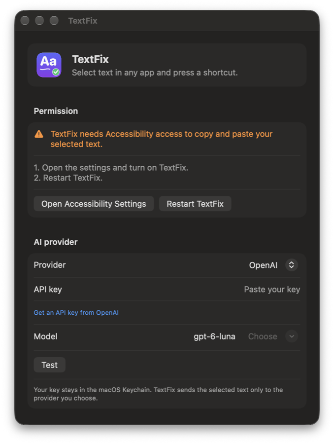

<p align="center"></p>

<h1 align="center">TextFix</h1>

<p align="center">Fix any text on your Mac with one shortcut.<br />Free, open source, and works with your own AI key.</p>

<p align="center"><a href="https://github.com/phollaki/textfix/releases/latest/download/TextFix.dmg"><b>Download TextFix for Mac</b></a> · <a href="https://textfix.puteanihollakos.com">Website</a></p>

Select text in any app, press a shortcut, and TextFix replaces the selection with the result.
It works in Mail, Slack, Teams, Notes, your browser and every other app where you can copy and paste.

| Shortcut | Action |
|---|---|
| Control+Option+R | Rephrase into plain, natural sentences |
| Control+Option+G | Fix spelling, grammar and punctuation |
| Control+Option+T | Translate to the language you pick (24 languages) |

You can change every shortcut in the settings.

<p align="center"></p>

## Install

1. Download [TextFix.dmg](https://github.com/phollaki/textfix/releases/latest/download/TextFix.dmg).
2. Open it and drag TextFix to Applications.
3. Open TextFix from Applications.
   The first time, macOS says it cannot check TextFix for malware, because the app is not notarized by Apple yet.
   Click "Done", open System Settings > Privacy & Security, scroll down and click "Open Anyway" next to TextFix.
4. In the TextFix window, click "Open Accessibility Settings" and turn on TextFix.
   TextFix needs this to press Copy and Paste for you.
   Then click "Restart TextFix".
5. Pick your AI provider, paste your API key and click "Test".

TextFix lives in the menu bar (✎).
Click the icon and choose "Settings…" to open the window again.

Requires macOS 14 or later, on Apple Silicon or Intel.

## AI providers

TextFix sends the selected text directly from your Mac to the provider you pick.
There is no TextFix server.
Your key is stored in the macOS Keychain.

| Provider | Default model | Get a key |
|---|---|---|
| OpenAI | `gpt-6-luna` | [platform.openai.com](https://platform.openai.com/api-keys) |
| Anthropic (Claude) | `claude-haiku-5-5` | [console.anthropic.com](https://console.anthropic.com/settings/keys) |
| Google Gemini | `gemini-3.5-flash-lite` | [aistudio.google.com](https://aistudio.google.com/apikey) |
| Mistral | `mistral-small-latest` | [console.mistral.ai](https://console.mistral.ai/api-keys) |
| Groq | `openai/gpt-oss-20b` | [console.groq.com](https://console.groq.com/keys) |
| OpenRouter | `openrouter/auto` | [openrouter.ai](https://openrouter.ai/settings/keys) |
| Ollama (on your Mac) | first installed model | No key. Install [Ollama](https://ollama.com) and download a model. |

You can type any model name, or click "Choose" to pick from the models your provider offers.
The defaults are small, fast models.
A typical rewrite costs a tiny fraction of a cent.

## Build from source

You need Xcode 16 or later.

```sh
git clone https://github.com/phollaki/textfix.git
cd textfix
open app/TextFix.xcodeproj
```

Run the TextFix scheme.
With ad hoc signing, macOS drops the Accessibility permission after each rebuild.
Set your own team in Signing & Capabilities to keep it.

To build the DMG:

```sh
app/build-dmg.sh
```

The DMG is written to `app/build/TextFix.dmg`.

## Repository

| Folder | Content |
|---|---|
| `app/` | Xcode project for the Mac app (Swift, AppKit, SwiftUI) |
| `web/` | Website: landing page, privacy policy and support page |
| `.github/workflows/deploy.yml` | Builds the website image and pushes it to GHCR |

The app icon comes from `app/icon.swift`:

```sh
swift app/icon.swift icon.png
```

## Release

1. Raise `MARKETING_VERSION` in the Xcode project.
2. Build the DMG with `app/build-dmg.sh`.
3. Create the release:

```sh
gh release create v1.0.0 app/build/TextFix.dmg --title "TextFix 1.0.0" --notes "..."
```

The download links always point to the DMG of the latest release.

## Website deploy

The website runs at [textfix.puteanihollakos.com](https://textfix.puteanihollakos.com).
Every push to `main` that changes `web/` builds a new image, and the server pulls it within a minute.
The server config lives in `srv/textfix/compose.yml` and `srv/proxy/sites/textfix.caddy` in the private `server-setup` folder.

## License

[MIT](LICENSE)

Made by [Ákos](https://puteanihollakos.com).
